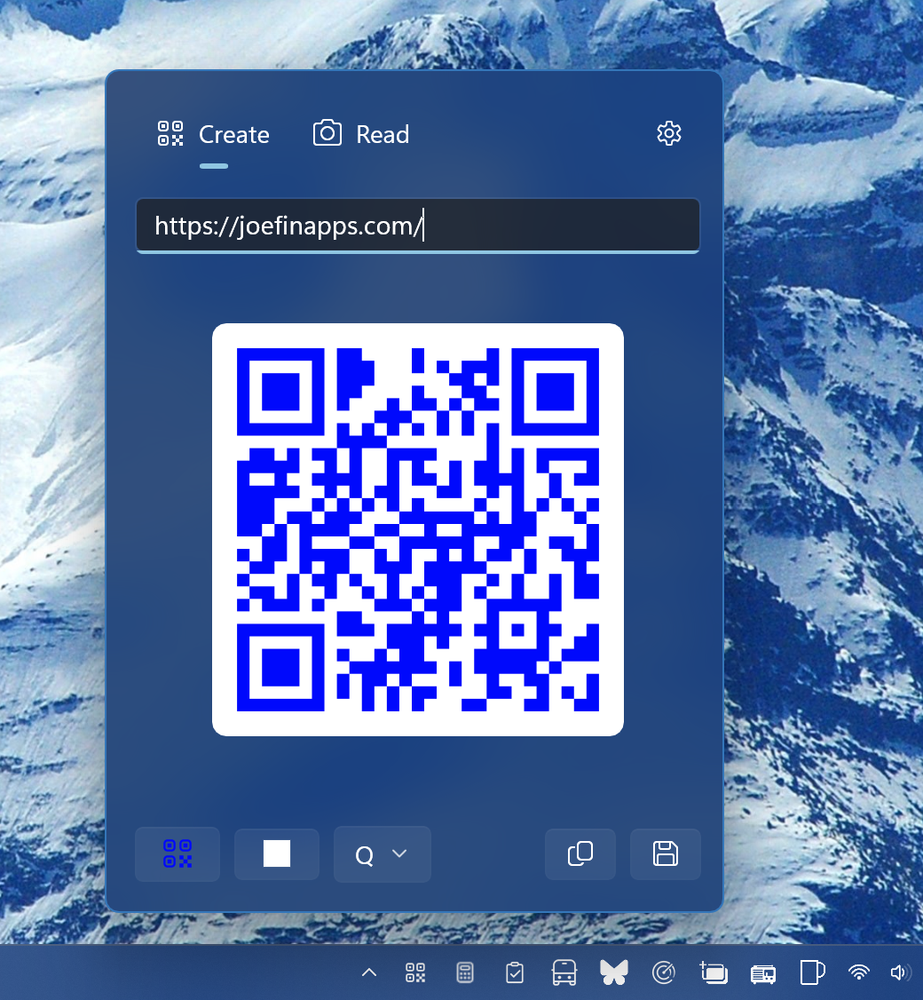

# Tray QR

Create and read QR codes from the Windows system tray.

Tray QR sits in the notification area. Click the icon to open a small flyout, type or paste some text, and the QR code appears. You can also point it at a QR code on screen or in an image to read what it says.



## Features

### Create
- The QR code updates as you type.
- Pick the code color and the background color, or reset to black on white.
- Choose the error-correction level (L, M, Q, H).
- Copy the image to the clipboard, save it as a PNG, or drag it into a folder, chat, or document.

### Read
- Snip part of the screen and read any codes in it.
- Paste an image from the clipboard (Ctrl+V), open an image file, or drop one onto the flyout.
- Open links, copy the decoded text, or turn a result into a new code.

### Tray app
- Tray icon only, with no main window. It follows the light or dark taskbar theme.
- Right-click the icon for **Open**, **Settings**, and **Exit**.
- Optionally start with Windows.
- Uses no network. Nothing runs while the flyout is hidden.

## Requirements

- Windows 10 1809 (build 17763) or later, x64 or ARM64
- To build from source: [.NET 10 SDK](https://dotnet.microsoft.com/download) and Developer Mode turned on

## Build and run

```powershell
$arch = $env:PROCESSOR_ARCHITECTURE
$Platform = if ($arch -eq 'AMD64') { 'x64' } else { $arch }

dotnet build -c Debug -p:Platform=$Platform
dotnet run   -c Debug -p:Platform=$Platform
```

`dotnet run` uses the [winapp CLI](https://github.com/microsoft/WinAppCli) to register the app with package identity and launch it. To test first-run behavior, use `winapp run --clean`.

### Tests

```powershell
cd TrayQr.Tests
dotnet test -c Debug -p:Platform=$Platform
```

## Built with

- [WinUI 3 / Windows App SDK](https://learn.microsoft.com/windows/apps/windows-app-sdk/)
- [ZXing.Net](https://github.com/micjahn/ZXing.Net) to encode and decode QR codes
- [WinUIEx](https://github.com/dotMorten/WinUIEx) and [CsWin32](https://github.com/microsoft/CsWin32)

## License

[MIT](LICENSE)
